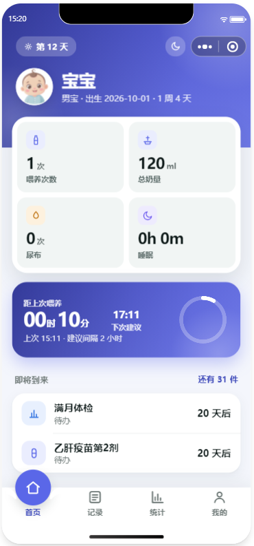
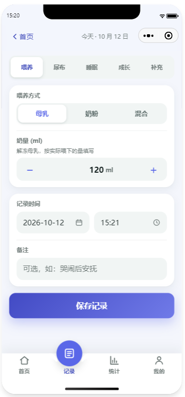
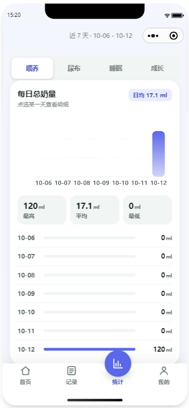
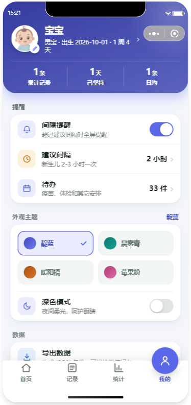
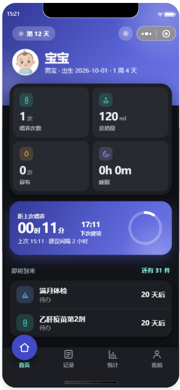
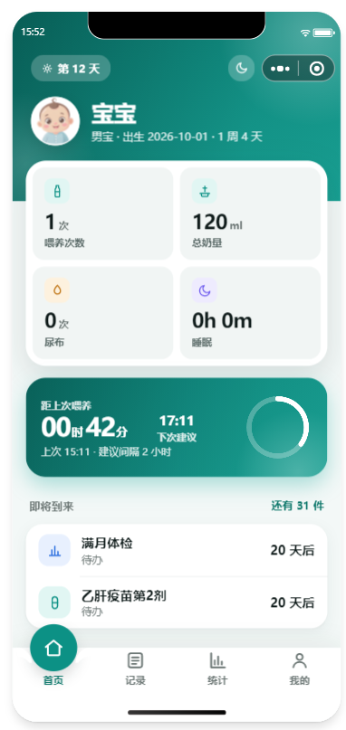
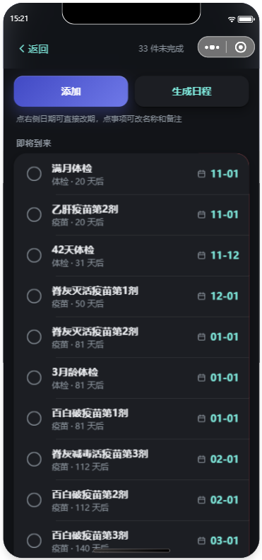
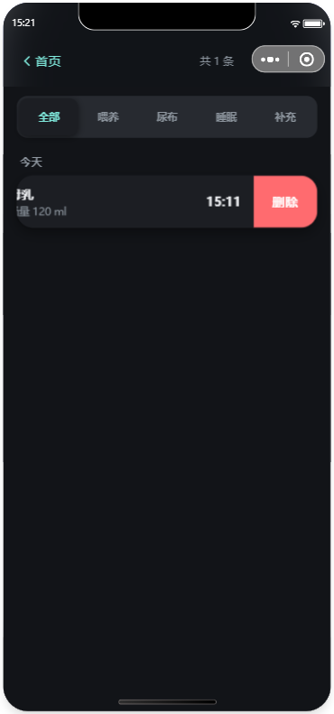
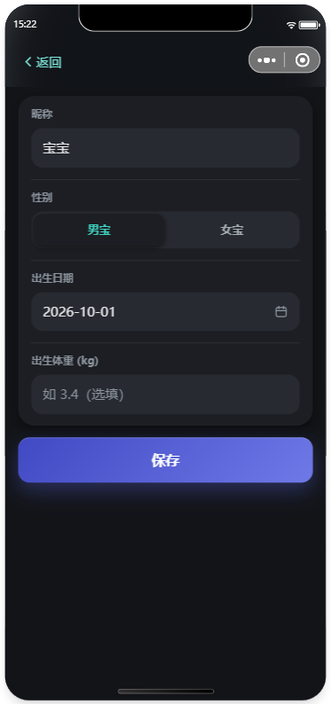
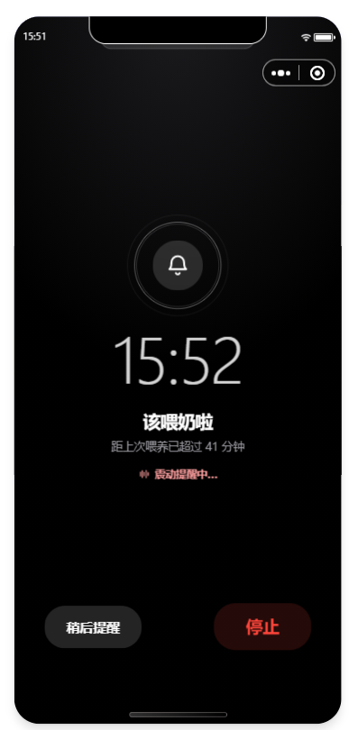

# 小芽拾光记 · 新生儿喂养记录

微信小程序。喂养、尿布、睡眠、体温、补充等记在本机，无账号、无后端；可导出 JSON / CSV 备份，也可生成摘要长图发给家人或医生。

## 体验小程序

微信扫码，或打开微信搜一搜「**小芽拾光记**」：

<p align="center">
  
</p>

## 快速运行

1. 打开 **微信开发者工具** → 导入项目，目录选本仓库根目录
2. AppID 可用测试号；正式发布时改 `project.config.json` 里的 `appid`
3. 编译即可；震动、转发文件等能力建议真机预览

## 界面

| 首页 | 记一笔 | 统计 | 我的 | 深色首页 |
| --- | --- | --- | --- | --- |
|  |  |  |  |  |

| 晨雾青首页 | 待办 | 全部记录 | 宝宝资料 | 提醒闹钟 |
| --- | --- | --- | --- | --- |
|  |  |  |  |  |

## 功能清单

| 模块 | 说明 |
| --- | --- |
| 首页 | 今日概览（喂养 / 奶量 / 尿布 / 补充）、今日体温、距上次喂养与下次预估、夜间「同上次再记一次」、待办预览、最近记录、深色切换、超时提醒 |
| 记一笔 | 喂养、尿布、睡眠、吸奶、俯卧、成长、体温、洗澡、维生素等补充；支持「同上一次」；可从历史进入编辑 |
| 统计 | 按区间使用频率排序的类型切换、趋势图与 KPI、自定义区间与环比；今日摘要 / 周报 / 月报 / **就诊包（近 7 天）** 长图 |
| 数据 | JSON 导出导入（合并 / 覆盖）、CSV、分享长图、**就诊包（摘要 + 待问医生）**、清空 |
| 我的 | 宝宝资料、坚持天数、喂养间隔提醒、四套主题与暗黑、待办 / 数据 / 更新日志等入口 |
| 待办 | 疫苗、体检等；可按出生日生成常见日程 |
| 提醒闹钟 | 超过设定间隔后的全屏提醒：贪睡或停止 |
| 全部记录 | 按类型筛选、按日折叠、左滑删除、点进编辑 |

## 技术说明

- **本地存储**：`wx.setStorageSync`，键名 `newborn_feed_v1`（baby / records / todos / settings）
- **主题**：CSS 变量 + 页面根 class（`t-{{theme}}` / `dark`），靛蓝 / 晨雾青 / 暖阳橘 / 莓果粉
- **图标**：`utils/icons.js` 内联 SVG data URI，无第三方图标库
- **图表 / 长图**：`utils/charts.js`、`utils/share.js`（canvas 2d）
- **导航**：自定义导航栏度量见 `utils/nav.js`；自定义 TabBar 见 `custom-tab-bar/`
- **导出导入**：优先 `shareFileMessage`，不支持时回退剪贴板；导入支持合并或覆盖

## 目录结构

```
newborn-feed-tracker/
├── app.js / app.json / app.wxss
├── theme.wxss
├── assets/
├── custom-tab-bar/
├── components/
├── utils/          # storage / stats / charts / share / export / theme …
└── pages/          # index / record / stats / mine / visit / history …
```

## 已知限制

- 模拟器不支持部分分享与震动 API，请以真机为准
- 导入不会覆盖本机当前主题 / 暗黑偏好
- 喂养提醒仅在打开小程序（进入首页）时检查；退到后台无法由系统主动弹窗

## 支持一下

如果「小芽拾光记」对你有帮助，欢迎：

- ⭐ **Star** 本仓库
- 🍴 **Fork** 后按自家习惯改
- 💬 提 [Issue](https://github.com/XH-fenger/newborn-feed-tracker/issues) 或发 PR

仓库：[GitHub](https://github.com/XH-fenger/newborn-feed-tracker) · [Gitee](https://gitee.com/fengger1102/newborn-feed-tracker)
